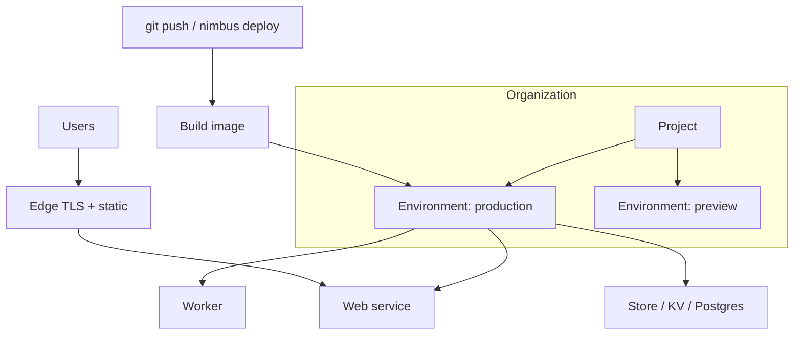

# Platform overview

Nimbus has a small number of nouns, arranged in a strict hierarchy. Understanding them makes everything else in these docs read naturally.

## The hierarchy

| Level | What it is |
| --- | --- |
| Organization | Billing boundary and member list |
| Project | One application; owns a `nimbus.yaml`, a region, and its resources |
| Environment | An isolated copy of the project: `production`, per-branch previews, or custom |
| Service | A deployable unit inside a project: `web`, `worker`, `cron`, or `static` |
| Resource | Attached storage: a Store bucket, a KV namespace, or a Postgres database |

Details on the top of the hierarchy are in [Projects and environments](/concepts/projects-and-environments); the bottom is covered in [Services](/concepts/services).

## Architecture at a glance

Traffic always enters through the edge. Service instances and data resources stay in the project's primary region unless a feature explicitly says otherwise.

## How a deploy flows

1. You run `nimbus deploy` (or push to a connected branch).
2. Nimbus builds each service into an immutable image — from its Dockerfile or a buildpack.
3. New instances start in the target environment and must pass their health check.
4. Traffic cuts over; old instances drain and stop. A failing health check aborts the deploy and leaves the previous version serving — see [Deployment errors](/troubleshooting/deployment-errors).

Every deploy gets an ID (`dep_...`) and shows up in `nimbus status` and the dashboard, with statuses moving through `queued → building → deploying → live` (or `failed`).

## Where things run

A project lives in one primary [region](/concepts/regions-and-edge). Static assets and TLS termination are pushed to the edge network in every region automatically; service instances run in the project's region.

## What Nimbus manages for you

TLS certificates, [autoscaling](/guides/compute/scaling), log collection and [metrics](/guides/observability/metrics), secret injection, health-checked rollouts, and daily Postgres backups. What stays yours: the application code, its dependencies, and the `nimbus.yaml` describing how it runs.
